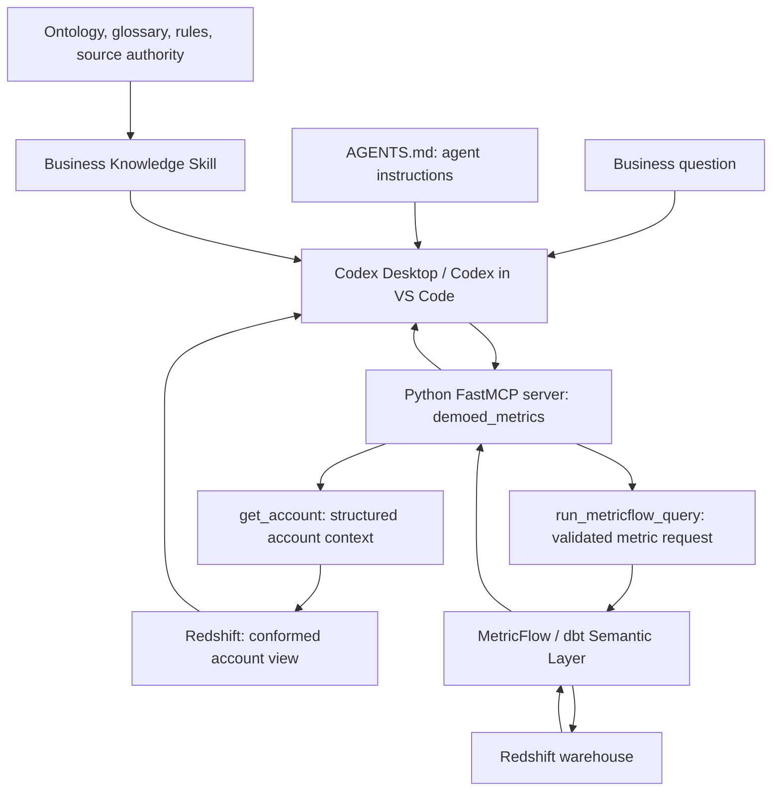

# Business Context for AI: Ontology + dbt Semantic Layer + MCP

> A practical prototype for answering business questions with **documented business meaning** and **governed metrics**, rather than asking an AI agent to guess from warehouse tables.

This project explores a simple question: **What does an AI assistant need to understand about a business before it can answer questions about that business's data?**

The prototype brings together:

1. **Business ontology and glossary** — concepts, relationships, business rules, exceptions, and source-of-truth guidance.
2. **Agent Skill** — routes questions to the relevant domain knowledge and tells the agent how to interpret it.
3. **dbt Semantic Layer / MetricFlow** — provides reusable metric definitions and compiles metric requests into SQL.
4. **Python MCP server** — exposes validated metric queries and structured account lookup tools to AI clients.
5. **Codex Desktop and Codex in VS Code** — consume the business context and MCP tools to investigate accounts, explain metrics, and visualize relationships.

## Why this matters

A data warehouse can show that an organization has product licenses, product usage, and zero ARR. But those facts alone do **not** establish whether the organization is a counted as a customer.

For example, an educational district may consume products funded by a state-level agreement. A useful AI answer must distinguish **who pays**, **who receives access**, **who uses the product**, and **which entity is counted as a customer**.

This prototype supplies those rules as explicit context and retrieves actual metric values separately. It aims to reduce confident but incorrect interpretations of business data.

## Architecture

**Separation of responsibility:** the ontology explains what concepts mean; MetricFlow defines and computes metrics; MCP offers controlled tools; Codex interprets the user request and combines results.

The ontology in this repository is maintained as **Markdown business-domain documentation with relationship diagrams**, not an OWL/RDF ontology or independently deployed graph database. Account-specific knowledge graphs in the demos are generated from documented relationships and retrieved facts.

## What is implemented

| Component | Responsibility | Code / documentation |
|---|---|---|
| Business Knowledge Skill | Topic routing, source precedence, ontology-aware reasoning | [SKILL.md](plugins/demoed-business-context/skills/demoed-business-context/SKILL.md) |
| Ontology | Account, Contract, License, Product, User, Usage, Support, Training, and related relationships | [ontology/](plugins/demoed-business-context/skills/demoed-business-context/ontology/) |
| Business glossary | Common terms and reporting definitions | [business_glossary.md](plugins/demoed-business-context/skills/demoed-business-context/knowledge/business_glossary.md) |
| ARR reference | Differences among True, Preliminary, and Backdated ARR | [annual_recurring_revenue_arr_knowledge.md](plugins/demoed-business-context/skills/demoed-business-context/knowledge/annual_recurring_revenue_arr_knowledge.md) |
| Cross-domain context | Authority, source-system differences, data-quality limitations | [business_context.md](plugins/demoed-business-context/skills/demoed-business-context/knowledge/business_context.md) |
| MCP server | FastMCP tools, validation, MetricFlow calls, account lookup | [metricflow_mcp.py](workbench/metricflow_mcp/metricflow_mcp.py) |
| MCP regression tests | Valid/invalid query contract checks using an available dbt/warehouse environment | [test_metricflow_query.py](workbench/metricflow_mcp/test_metricflow_query.py) |
| Codex instructions | Direct the agent to use ontology and MCP rather than inventing metric names or business rules | [AGENTS.md](AGENTS.md) |

The metric definitions themselves are supplied by a connected dbt project; **the original dbt warehouse project and its data are not bundled here**. Consequently, cloning this repository alone is not sufficient to reproduce queries against the original environment.

## Example: what counts as a customer?

**Question:** "Does this district count as a current customer if its students use the product but its ARR is zero?"

The agent should:

1. Read the documented definition of *Customer* and the distinction between operational and commercial account hierarchies.
2. Identify the requested organization using `get_account` (and disambiguate similar names, if necessary).
3. Retrieve the relevant metrics through `get_metrics`, `get_dimensions`, and `run_metricflow_query`.
4. Explain the distinction between an organization using the product and an ultimate-parent organization contributing nonzero active-contract ARR.
5. State what is known and what remains unresolved instead of inventing a payer relationship.

The crucial improvement is **business interpretation**, not merely generating SQL.

## Demo walkthroughs

See **[AI-assisted business analysis: annotated demos](demo/README.md)** for examples and a proposed screenshot gallery:

- Customer definition vs. licenses and usage
- Account discovery and operational/commercial hierarchies
- Account-specific knowledge graphs
- ARR trends and metric exploration
- Name ambiguity, evaluation accounts

## MCP tools

The Python server exposes:

| Tool | What it does |
|---|---|
| `get_metrics` | Discovers available MetricFlow metrics |
| `get_dimensions` | Discovers valid dimensions for a selected metric |
| `get_state_codes` / `get_countries` | Provides controlled values for geographic filters |
| `run_metricflow_query` | Validates a query request and executes it through MetricFlow |
| `get_account` | Looks up a conformed account; returns candidate matches or structured account context |

Detailed implementation and environment requirements: [MCP server README](workbench/metricflow_mcp/README.md).

## Using with Codex

- [Codex Desktop + local MCP setup](README_Codex_Desktop_MCP.md)
- [Codex VS Code extension + local MCP setup](README_Codex_VSCode_MCP_Setup.md)
- [Repository agent instructions](AGENTS.md)

Both setup guides describe a **local Python MCP server using `stdio`**. Adapt the paths to your machine and use your own authorized data environment. Never commit credentials or local `.env` files.

## Scope and limitations

- This is a **working prototype and documentation case study**, not a hosted application or an independently runnable demo warehouse.
- The knowledge sources include deliberate ambiguity and known data-quality issues; the agent should preserve those uncertainties rather than invent conclusions.
- The MCP server uses a direct warehouse account lookup as well as MetricFlow queries. Not every value is retrieved through the same interface.
- The current code uses fixed allowed state/country lists and a query-result cap; the account-matching flow can require user clarification.
- The regression tests cover valid/invalid query outcomes, **not numeric reconciliation of metrics**.

**Portfolio emphasis:** business ontology semantic modeling dbt MetricFlow MCP / FastMCP Python SQL Amazon Redshift AI agents business rules data quality
