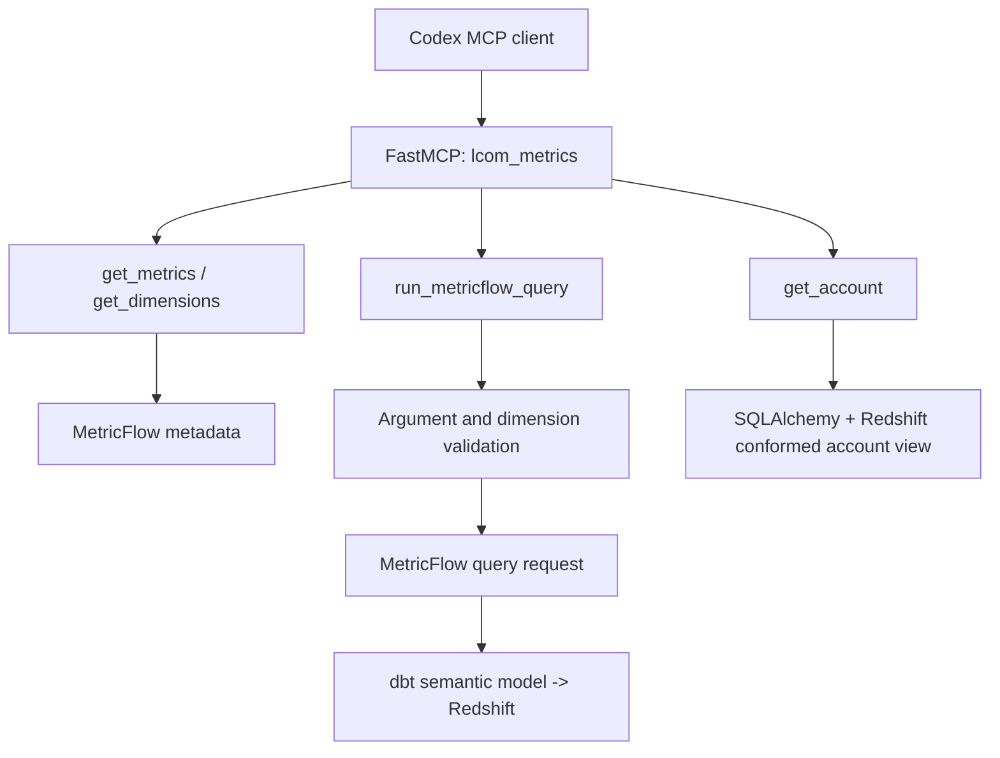

# lcom_metrics: Python MCP Server for dbt MetricFlow

A local **FastMCP** server exposing controlled metric discovery, semantic queries, and structured account lookup to Codex through **MCP `stdio`**.

This README documents the implementation in [metricflow_mcp.py](metricflow_mcp.py). It is a prototype tied to a particular dbt/Redshift data environment, not a standalone hosted metrics service.

## Data flow



The `get_account` path directly queries a warehouse account view for organizational context (account dimensional attributes vs metrics); the `run_metricflow_query` path uses MetricFlow. These are deliberately separate operations.

## MCP tools

| Tool | Parameters / role |
|---|---|
| `get_metrics()` | Discover current MetricFlow metric names |
| `get_dimensions(metric)` | Get supported dimensions for a metric |
| `get_state_codes()` | Get allowed state-code filter values |
| `get_countries()` | Get allowed country filter values |
| `run_metricflow_query(metrics, group_by, where, start_time, end_time, order, limit)` | Validate then execute a MetricFlow query |
| `get_account(account_name, state_code, district_name)` | Search conformed accounts; disambiguate matches; return structured context |

`get_account` produces a structured result describing, when available, operational and commercial hierarchy, account identity, program eligibility, licensing/usage indicators, commercial activity, and support/training summaries. Numeric metric queries should still use the semantic metric tool rather than infer values from this record.

## Validation behavior

The implementation checks requested metric and dimension names against MetricFlow, controlled state/country values against allowed lists, date formats and ranges, ordering, and result limits. Valid queries return `success: true` with data; errors return `success: false` with an error type and message.

**Current implementation details:**

- The server sets `MAX_QUERY_LIMIT = 100` in its Python code.
- State and country allowed values are currently **hardcoded** (dynamic database-driven retrieval is future work).
- A partial account name can match multiple rows. Clients should surface candidate matches and ask for clarification; they should not choose one silently.


## Environment required

- A working Python environment
- An accessible dbt project containing compatible MetricFlow semantic models
- A compatible Redshift connection in the dbt `profiles.yml`
- Network/database permissions for the executing machine
- A local `.env` file pointing at the appropriate project and profile locations

The server imports `fastmcp`, `dbt_metricflow`, `metricflow`, `pandas`, `python-dotenv`, `yaml`, `sqlalchemy`, and the relevant Redshift/PostgreSQL adapter packages. 

```powershell
python -m pip install fastmcp dbt-metricflow dbt-redshift python-dotenv pandas
python -m pip install sqlalchemy sqlalchemy-redshift psycopg2-binary pyyaml pytest
```

Example `.env` **template** (do not commit actual connection information):

```dotenv
DBT_PROJECT_DIR=C:\path\to\your\dbt_project
DBT_PROFILES_DIR=C:\Users\your-user\.dbt
DBT_TARGET=dev
```

The code expects the original dbt profile name used by the project in the account-lookup implementation; adapting to another project may require changing that profile lookup and the `semantic.vws_account` mapping.

## Start the server

With the correct virtual environment and `.env`, run from this directory:

```powershell
python metricflow_mcp.py
```

The entry point uses `mcp.run(transport="stdio")`. When started by Codex, this process should not emit ordinary debug messages to `stdout`, because that stream is used by the MCP protocol.

Configure your client using one of the existing guides:

- [Codex Desktop](../../README_Codex_Desktop_MCP.md)
- [Codex VS Code](../../README_Codex_VSCode_MCP_Setup.md)

## Suggested test prompts

```text
Use the lcom_metrics tools to list the available metrics.
What dimensions are available for arr?
What was ARR by state for a specified reporting month?
Find the account named "Example District" and show me any ambiguous matches.
```


## Tests

[test_metricflow_query.py](test_metricflow_query.py) contains parameterized tests for valid and invalid query requests. These are **integration/regression tests** that require access to the configured dbt project and database. They assert success and validation-error contracts, **not exact metric totals**.

```powershell
python -m pytest test_metricflow_query.py -v
```


## Known limitations / next improvements

- Replace hardcoded dimension-value lists with warehouse-driven discovery.
- Add metric-value reconciliation tests against known source queries.
- Improve paging and ambiguity handling in account lookup.
- Package dependencies and provide a runnable synthetic dataset.
- Parameterize the database profile/account view for portability.
- Audit return sizes, data masking, and role-based access before exposing this to broader users.

See the [main README](../../README.md) for architecture and the [demo README](../../docs/demo/README.md) for end-to-end examples.
